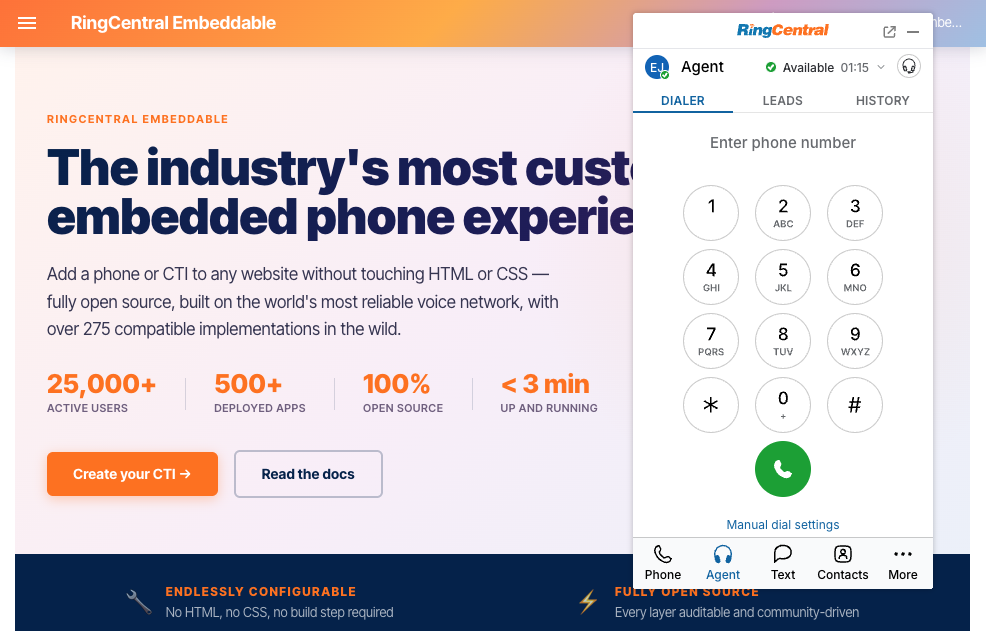

# RingCX Embeddable

## Introduction

RingCX support has been merged into [RingCentral Embeddable](https://embeddable.labs.ringcentral.com/3.1.x/). Starting with **RingCentral Embeddable 3.1.x**, a single embeddable widget lets developers integrate both RingCentral RingEX (phone, SMS, meetings) and RingCX (contact center agent) services into their web applications with a few lines of code.

!!! tip "Recommended: use RingCentral Embeddable 3.1.x for RingCX"
    We recommend that new integrations use RingCentral Embeddable 3.1.x with RingCX enabled. The standalone [RingCX Embeddable](https://github.com/ringcentral/engage-voice-embeddable/) (`engage-voice-embeddable`) is superseded by RingCentral Embeddable. Existing integrations should follow the [migration guide](#migrating-from-the-standalone-ringcx-embeddable) below.

> **RingCX support is part of the RingCentral Embeddable 3.1.x beta.** We welcome your feedback and bug reports — please feel free to open an issue on [GitHub](https://github.com/ringcentral/ringcentral-embeddable/issues).

## Supported features

* One RingCentral login for both RingEX and RingCX — no second login or extra app scope
* Agent tab with agent session and agent states
* Voice queues
* Dial modes
    * Manual
    * Predictive dial mode
    * Preview dial mode (leads)
    * Progressive dial mode
* Call disposition
    * Notes
    * Disposition
    * AI Summary
* Agent scripts
* Voicemail drop
* Call logging, contact matching and lead viewing in your app, using the same service protocol as RingEX calls

## Visit Online

Visit the online demo: [https://apps.ringcentral.com/integration/ringcentral-embeddable/3.1.x/index.html](https://apps.ringcentral.com/integration/ringcentral-embeddable/3.1.x/index.html)



## Enable RingCX

Register your app and get a RingCentral client ID by following [Registering your application](https://embeddable.labs.ringcentral.com/app-registration/). Then add the following code into any web app's page, with `enableRingCX=1` in the `adapter.js` URL:

```html
<script>
  (function() {
    var rcs = document.createElement("script");
    rcs.src = "https://apps.ringcentral.com/integration/ringcentral-embeddable/3.1.x/adapter.js?clientId=YOUR_RINGCENTRAL_CLIENT_ID&enableRingCX=1";
    var rcs0 = document.getElementsByTagName("script")[0];
    rcs0.parentNode.insertBefore(rcs, rcs0);
  })();
</script>
```

RingCX is off by default and cannot be turned on at runtime. When `enableRingCX` is on and the signed-in RingCentral user has a RingCX account, the widget shows an **Agent** tab. The agent session starts when the user starts it from the Agent tab, or when your page calls `RCAdapter.startRingCXAgentSession()`. A session that has reached `ready` is restored automatically when the widget reloads, until the agent ends it.

Optional parameters:

| Parameter | Default | Description |
|-|-|-|
| `enableAgentScript` | off | Show RingCX agent scripts in the side panel during calls. Use it with `enableSideWidget=1`. |
| `enableVoicemailDrop` | off | With `enableSideWidget=1`, lets agents drop a pre-recorded message on outbound RingCX calls. |

See [All parameters](https://embeddable.labs.ringcentral.com/config/) for the full list.

## Integrate with your app

RingCX calls use the same `rc-*` events and `rc-adapter-register-third-party-service` protocol as RingEX calls, so you do not need a second protocol. Read `call.source`: `'ringcx'` means a RingCX call, and RingCX-only fields are under `call.ringcx`.

Register your service, then handle call logging, contact matching and lead viewing requests:

```js
var registered = false;
function postToWidget(message) {
  document.querySelector("#rc-widget-adapter-frame").contentWindow.postMessage(message, '*');
}

window.addEventListener('message', function (e) {
  var data = e.data;
  if (!data) {
    return;
  }
  // Register the service when the widget is loaded
  if (data.type === 'rc-login-status-notify' && !registered) {
    registered = true;
    console.log('RingCX available:', data.features && data.features.ringCX);
    postToWidget({
      type: 'rc-adapter-register-third-party-service',
      service: {
        name: 'TestService',
        callLoggerPath: '/callLogger',
        callLoggerTitle: 'Log to TestService',
        callLogEntityMatcherPath: '/callLogger/match',
        contactMatchPath: '/contacts/match',
        leadViewerPath: '/leads/view', // adds "View lead" button in the Lead tab
      }
    });
  }
  // Call events
  if (data.type === 'rc-call-ring-notify' || data.type === 'rc-call-start-notify') {
    if (data.call.source === 'ringcx') {
      console.log('RingCX call:', data.type, data.call);
    }
  }
  if (data.type === 'rc-ringcx-call-disposed-notify') {
    console.log('disposition:', data.call.ringcx.disposition, data.call.ringcx.notes);
  }
  if (data.type === 'rc-ringcx-agent-state-notify') {
    console.log('agent state:', data.state, data.auxState);
  }
  if (data.type === 'rc-ringcx-lead-notify') {
    // action: loaded, passed, dialed or updated
    console.log('lead event:', data.action, data.leads || data.lead);
  }
  // Requests from the widget
  if (data.type === 'rc-post-message-request') {
    if (data.path === '/callLogger') {
      // triggerType 'callDisposition' means the call is logged automatically after disposition
      console.log('log call:', data.body.triggerType, data.body.call);
      postToWidget({ type: 'rc-post-message-response', responseId: data.requestId, response: { data: 'ok' } });
    }
    if (data.path === '/callLogger/match') {
      // map call ids from the request to your logged entities; for RingCX calls, the id is the RingCX call uii
      postToWidget({ type: 'rc-post-message-response', responseId: data.requestId, response: { data: {} } });
    }
    if (data.path === '/contacts/match') {
      var contactMapping = {};
      data.body.phoneNumbers.forEach(function (phoneNumber) {
        contactMapping[phoneNumber] = [{
          id: phoneNumber,
          type: 'TestService',
          name: 'Test User ' + phoneNumber,
          phoneNumbers: [{ phoneNumber: phoneNumber, phoneType: 'direct' }],
        }];
      });
      postToWidget({ type: 'rc-post-message-response', responseId: data.requestId, response: { data: contactMapping } });
    }
    if (data.path === '/leads/view') {
      console.log('view lead:', data.body.lead);
      postToWidget({ type: 'rc-post-message-response', responseId: data.requestId, response: { data: 'ok' } });
    }
  }
});
```

You can also control the widget through the global `RCAdapter` object, for example to place a RingCX call:

```js
RCAdapter.clickToCall(phoneNumber, { callWith: 'ringcx' });
```

Other helpers include `startRingCXAgentSession()`, `endRingCXAgentSession()`, `setRingCXAgentState(state)`, `dialRingCXLead(lead, destination)` and `controlCall(action, id, { source: 'ringcx' })`.

See [RingCX in Embeddable](https://embeddable.labs.ringcentral.com/integration/ringcx/) for the full list of events, commands, message requests, and call logging behavior.

## Migrating from the standalone RingCX Embeddable

If you are using the standalone [RingCX Embeddable](https://github.com/ringcentral/engage-voice-embeddable/) (`ringcx-embeddable` / `engage-voice-embeddable`), replace its `adapter.js` with the RingCentral Embeddable 3.1.x `adapter.js` shown above, and map its events as follows:

| Standalone RingCX Embeddable | RingCentral Embeddable 3.1.x |
|-|-|
| `rc-ev-ringCall` | `rc-call-ring-notify` |
| `rc-ev-newCall` | `rc-call-start-notify` |
| `rc-ev-endCall` | `rc-call-end-notify` |
| `rc-ev-sip*` | `rc-webphone-connection-status-notify` |
| `rc-ev-clickToDial` | `rc-adapter-new-call` with `callWith: 'ringcx'` |
| `rc-ev-dialLead` | `rc-adapter-ringcx-dial-lead` |
| `rc-ev-loadLeads`, `rc-ev-manualPassLead`, `rc-ev-callLead` | `rc-ringcx-lead-notify` with action `loaded`, `passed`, or `dialed` |
| `rc-ev-logout` | `rc-adapter-ringcx-end-agent-session` |
| `rc-ev-setEnvironment` | `evServer` parameter |
| `rc-ev-register` | `rc-adapter-register-third-party-service` |
| `rc-ev-matchContacts` | `contactMatchPath` |
| `rc-ev-matchCallLogs` | `callLogEntityMatcherPath` |
| `rc-ev-logCall` | `callLoggerPath` |
| `rc-ev-viewLead` | `leadViewerPath` |
| `rc-ev-sideWidgetOpenNotify` | `rc-adapter-side-drawer-open-notify` |
| `rc-ev-setSideWidgetExtended` | Not carried. The host controls the drawer. |

Note that `contactMatchPath` receives plain phone numbers, the same as for RingEX calls. The phone-plus-call-type match key from the standalone RingCX Embeddable is no longer used; the call type is available on `call.ringcx.callType`.

See [Migrating from the standalone RingCX Embeddable](https://embeddable.labs.ringcentral.com/integration/ringcx/#migrating-from-the-standalone-ringcx-embeddable) for the latest details.

## Documentation

* [RingCentral Embeddable 3.1.x](https://embeddable.labs.ringcentral.com/3.1.x/)
* [RingCX in Embeddable](https://embeddable.labs.ringcentral.com/integration/ringcx/)
* [Registering your application](https://embeddable.labs.ringcentral.com/app-registration/)
* [All parameters](https://embeddable.labs.ringcentral.com/config/)
* [Service registration](https://embeddable.labs.ringcentral.com/integration/)
* [Log calls](https://embeddable.labs.ringcentral.com/integration/call-logging/)
* [Events](https://embeddable.labs.ringcentral.com/integration/events/)
* [API](https://embeddable.labs.ringcentral.com/integration/api/)
* [RingCentral Embeddable GitHub repository](https://github.com/ringcentral/ringcentral-embeddable)

### Legacy: standalone RingCX Embeddable

The standalone RingCX Embeddable is still available on [GitHub](https://github.com/ringcentral/engage-voice-embeddable/) for existing integrations, but it is no longer recommended for new projects.
